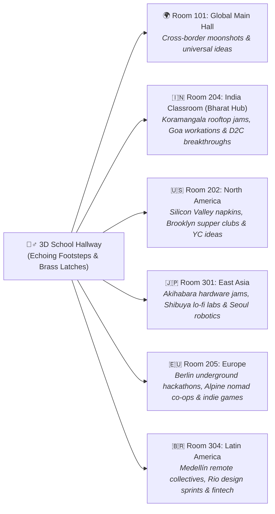
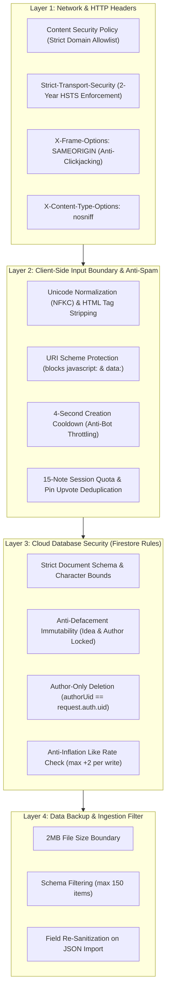

# 🏫 Worldwide Idea Board — Global Chalkboard Campus

<div align="center">

[](https://ideaboard-f7ed6.web.app)
[](https://ideaboard-f7ed6.web.app)
[](https://ideaboard-f7ed6.web.app)
[](LICENSE)

**"Where midnight thoughts become worldwide collaborations."**

*A live, sensory, real-time chalkboard vision campus connecting builders, dreamers, hackers, and travelers across the globe.*

[🌐 Step Onto the Campus](https://ideaboard-f7ed6.web.app) • [🎬 Campus Lore](#-chapter-1-the-214-am-epiphany) • [🏫 Hallway Tour](#-chapter-2-walking-the-corridor) • [🛡️ Security Grimoire](#-fort-knox-on-slate-the-4-layer-security-grimoire) • [🚀 Deploy Guide](#-instant-deployment-portal)

---

</div>

## 📖 Chapter 1: The 2:14 AM Epiphany

It’s 2:14 AM. 

You’re sitting on a balcony in Bengaluru, Tokyo, Lisbon, or San Francisco with a warm cup of coffee or cutting chai. Out of nowhere, a lightning bolt hits you — a moonshot product idea, a dream travel cooperative, or a weird community hackathon concept.

```
       ┌────────────────────────────────────────────────────────┐
       │   "What if two strangers reading the same Wikipedia    │
       │    article at 2 AM could voice chat for 5 minutes?"    │
       └────────────────────────────────────────────────────────┘
```

If you type it into your phone's Notes app, it sits in a digital graveyard for three years. If you tweet it, an algorithmic feed swallows it in six seconds.

**So you walk into the Global Chalkboard Campus.**

You hear the heavy oak door swing shut. Rain gently taps against the glass panes. A dusty green slate wall stretches across the room, dotted with colorful pastel sticky notes pinned by builders on five different continents. You grab a stick of mint chalk, double-click anywhere on the slate, and pin your idea to the world.

---

## 🚶‍♂️ Chapter 2: Walking the Corridor (Choose Your Hall)

The campus is divided into **6 live regional classrooms**, connected by an authentic **3D First-Person POV Hallway Transition**. Click **"Walk the Corridor"** in the top bar to step into the school hallway, listen to footsteps echoing down the floorboards, and turn the brass door handle into your destination:



<details>
<summary><b>🔍 Peek Inside Each Regional Room (Click to expand)</b></summary>

| Room | Hub Name | Regional Atmosphere |
| :--- | :--- | :--- |
| **Room 101** | `🌍 Global Main Hall` | Universal moonshots, remote work experiments, skill-swap hostels, and decentralized vision boards. |
| **Room 204** | `🇮🇳 Bharat Hub` | UPI micro-innovations, EV charging grids for tier-2 cities, chai-stall SaaS, and indie hackathons. |
| **Room 202** | `🇺🇸 North America` | AI agent workflows, open-source hardware, rooftop urban farming, and early-stage startup brainstorms. |
| **Room 301** | `🇯🇵 East Asia` | Tokyo train station sound synthesizers, cyber-café co-living, and anime-inspired dev tools. |
| **Room 205** | `🇪🇺 Old World Hackers` | Open-source privacy tooling, overnight sleeper train collectives, and indie game dev retreats. |
| **Room 304** | `🇧🇷 Latin America` | Solar-powered community mesh networks, street art NFTs, and coffee farmer logistics. |

</details>

---

## 🎧 Chapter 3: The Sensory Physics Engine

Every interaction on the campus is powered by a **mathematically synthesized Web Audio engine** — no external `.mp3` or `.wav` sound files needed! Everything is generated live via oscillators and procedural noise buffers:

```
[Web Audio Synthesis Pipeline]
Pink Noise Buffer ──► Bandpass Filter (1600Hz -> 700Hz) ──► Gain Envelope ──► Crisp Paper Peel
White Noise Buffer ─► Resonant Lowpass (600Hz) ──────────► Linear Decay ───► Felt Duster Swipe
Square Wave Tone ───► Bandpass Filter (320Hz) ────────────► Fast Attack ───► Tactile Push Pin
Procedural Buffer ──► Multi-band Filter Matrix ───────────► Loop Gain ─────► Cozy Night Rain
```

* 📌 **Push-Pin Impact:** Sharp transient click with low-frequency board resonance when notes are stuck.
* 📄 **Tactile Paper Rustle:** Filtered pink noise sweep that sounds like real 3M Post-It paper peeling off the wall.
* 🧽 **Felt Duster Sweep:** Textured grain that mimics a wool eraser gliding across school slate.
* ☕ **Cozy Soundscape Ambience:** Switch between **Night Rain against Window Glass**, **Lo-Fi Vinyl Crackle**, and a **Vintage School Wall Clock** right from the top navigation.

---

## 🛠️ Chapter 4: The Chalkboard Ledge & Magic Toolbox

Glance at the wooden tray running along the bottom of the board:

```
┌────────────────────────────────────────────────────────────────────────────────────────┐
│  [🟡 Yellow] [🌸 Pink] [💧 Blue] [🌱 Mint] [🍇 Purple] [🍑 Peach]   [🧽 Chalk Duster]  │
└────────────────────────────────────────────────────────────────────────────────────────┘
```

1. **Pastel Sticky Notes:** Pick between 6 hand-curated pastel paper colors (Sunburst Yellow, Cherry Blossom Pink, Sky Blue, Seafoam Mint, Lavender Lilac, and Peach Sorbet).
2. **Tactile Reaction Stamps:** Don't just like an idea — stamp it!
   * 🔥 `HOT` — Slap fire on sizzling concepts.
   * 💡 `GENIUS` — Acknowledge high-IQ breakthroughs.
   * 🤝 `COLLAB` — Signal that you want to team up.
   * 🚀 `SHIP IT` — Demand this gets built immediately.
3. **Felt Chalk Duster:** Pick up the eraser with `E` or click it from the tray to scrub away chalk markings or wipe sticky notes off the board (with full **1-Click Undo** protection!).
4. **📸 Vintage Polaroid Snapshot Camera:** Click the camera icon in the HUD to instantly capture a high-res vintage Polaroid photograph of your active classroom with authentic handwritten room watermarks and timestamps!

---

## 🛡️ Fort Knox on Slate: The 4-Layer Security Grimoire

Building a public worldwide collaborative wall requires military-grade defenses against defacement, wipes, and bot spam:



### The 4 Sacred Invariants:
1. **The Anti-Defacement Spell:** Existing sticky notes **cannot be altered by any visitor**. On update, `idea`, `author`, `authorUid`, `classroom`, and `createdAt` are strictly **IMMUTABLE**.
2. **The Anti-Vandalism Boundary:** You can only delete sticky notes that you authored (`authorUid == request.auth.uid`). No rogue visitor can wipe out the global campus.
3. **The Anti-Spam Gate:** Enforces a 4-second delay between pinning ideas, throttles reaction stamps to 1.2 seconds, and caps single-session notes to 15.
4. **XSS Exorcism:** All inputs pass through `sanitizeInput()` and render strictly via `escapeHtml()` and DOM `.textContent`.

---

## 🎮 Keyboard Shortcuts

| Key | Action |
| :---: | :--- |
| **`Double-Click`** | Pin a new note right under your cursor anywhere on the board |
| **`Click + Drag`** | Drag any sticky note around the room to reorganize thoughts |
| **`Spacebar (Hold)`** | Pan the infinite chalkboard camera smoothly across the room |
| **`E`** | Pick up or stow the Felt Chalk Duster |
| **`C`** | Pick up or stow the Colored Chalk Stick |
| **`Esc`** | Put all tools back on the wooden tray & close open modals |

---

## 🚀 Instant Deployment Portal

### 🔥 Option A: Deploy to Firebase Hosting (Recommended)

Because your database and hosting live together in the exact same Google project:

```powershell
# 1. Log in to your Firebase account
firebase login

# 2. Deploy website and security rules live!
firebase deploy
```

Your campus is live at:  
👉 **`https://<your-project-id>.web.app`**

---

### ⚡ Option B: Deploy to Vercel (Drag & Drop)

1. Go to [vercel.com/new](https://vercel.com/new).
2. Drag and drop this `IdeaBoard` folder into the dashboard.
3. Click **Deploy**!

---

## 🧰 Tech Stack & Architecture

* **Frontend:** Vanilla HTML5, Vanilla JavaScript (ES Modules), Tailwind CSS
* **Audio Synthesis:** Web Audio API (Procedural Oscillators & Noise Buffers)
* **Real-Time Cloud Sync:** Google Cloud Firebase Firestore (`onSnapshot` WebSocket)
* **Hosting & Edge Delivery:** Firebase Hosting / Vercel (Global Edge CDN)
* **Typography:** Fredericka the Great, Permanent Marker, Caveat, Indie Flower, Inter
* **Icons:** Phosphor Icons

---

## 📜 License

Crafted with ❤️ and chalk dust under the [MIT License](LICENSE).  
*Fork it, pin your dreams, and build something the world will remember.*
